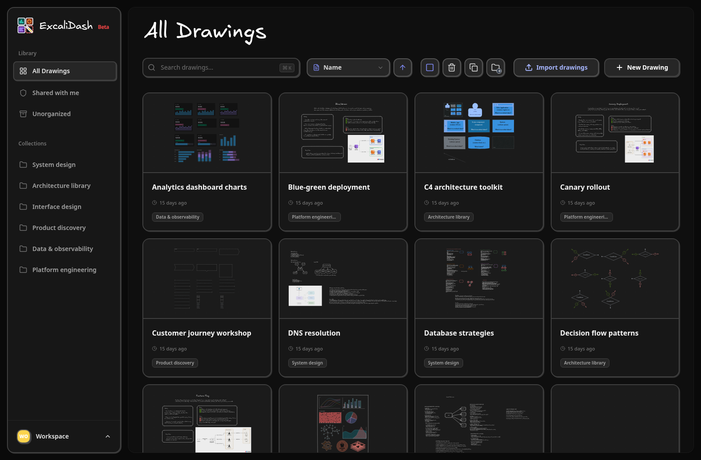

# ExcaliDash for ChatGPT Sites

A Sites-oriented adaptation of [ExcaliDash](https://github.com/ZimengXiong/ExcaliDash),
with the original React/Excalidraw frontend, ChatGPT identity, Cloudflare D1 metadata,
and R2 scene and image storage. This fork is independently maintained.

[](https://excalidash.xyz)

| Component | Current baseline |
| --- | --- |
| ExcaliDash | 0.6.7 (`0f9be2d8649be7650e6bee2844739c584fa76c35`) |
| Excalidraw editor | `0.18.0-4ce8305`, excalidraw.com `release` build `4ce8305` (2026-10-27); pinned independently of ExcaliDash 0.6.7's `0.18.1` |
| Sites runtime | Vinext build integration and Cloudflare Worker |

The pinned editor includes sticky notes, Bucket Fill and lasso selection.
Settings → Advanced shows the bundled editor version and its comparison with
excalidraw.com. See the [editor update procedure](docs/UPDATES.md#actualizar-el-editor-excalidraw).

## Features

- Original dashboard, drawing editor, collections, search and sorting.
- Autosave with version checks and conflict reconciliation.
- Version history, preview and restore.
- Private image uploads and downloads, drawing duplication and trash.
- Per-user Excalidraw library and preferences.
- `.excalidraw` import/export and upstream-compatible `.excalidash` ZIP backups.
- Cross-session collaboration through authenticated HTTP polling.

Hosted identity comes from ChatGPT Sites. Every data operation checks the user and
record ownership. The current edition is intended for personal workspaces: external
share links and cross-user drawing/collection grants are not implemented. Site access
is managed through Sites; granting someone access does not merge their data with yours.

## Local setup

Requires Node.js 24.22.1 or later, pnpm 11.25.0, and npm 10.9.2. Root and frontend
use separate lockfiles so the original React 18 frontend stays independent from
the Sites shell.

```sh
corepack pnpm install --frozen-lockfile
npx -y npm@10.9.2 --prefix frontend ci
npm run build
npm run test:frontend
npm run test:adapter
npm run check:public-source
npm run check:editor-upstream -- --offline
```

If Corepack is unavailable, install the pinned pnpm version and run `pnpm install
--frozen-lockfile`. Inside ChatGPT Work, prefer the Sites plugin's dependency installer
for the root and then the frontend. See [deployment instructions](docs/DEPLOYMENT.md)
for local D1 migrations, preview, publishing and updating an existing Site.

`npm run dev` prepares the SPA before starting the server. The retained frontend is
built into static assets; after editing frontend files, rerun `node
scripts/prepare-frontend.mjs` and refresh. Backend changes use the preview server's
normal reload behavior.

## Architecture

| Path | Responsibility |
| --- | --- |
| `frontend/` | Retained React/Vite/Excalidraw application and regression tests |
| `worker/index.ts` | Routes API requests to the adapter and serves the SPA |
| `server/api.ts` | Original REST contracts adapted to Workers, D1 and R2 |
| `db/`, `drizzle/` | Schema and append-only D1 migrations |
| `scripts/` | Sites build integration, environment helpers and SPA preparation |
| `upstream-backend/`, `upstream-docs/` | Original Node backend and docs, retained as reference |
| `upstream.json` | Exact ExcaliDash and editor provenance and update policies |

D1 stores users, preferences, collections, drawing metadata, history references,
file references and short-lived collaboration events. R2 stores immutable scene
revisions and image bytes. Atomic D1 batches and optimistic version checks protect
concurrent saves; history references remain available until permanent drawing deletion.

Collaboration uses one-second event polling, throttled cursors and five-second
persisted-scene recovery. It is suitable for multiple sessions of the same account;
it does not provide a persistent Socket.IO server or WebSocket latency.

## Limits and differences from upstream

- Authentication is managed by Sites; local passwords, SMTP, bootstrap administration
  and user API keys are not implemented by the deployed adapter.
- Images: 10 MB each. JSON request bodies: 16 MB. Backup uploads: 20 MB compressed,
  40 MB expanded, up to 500 drawings, 500 collections and 1,000 ZIP entries.
- Backups export current scenes with embedded images, not the complete version history.
  Import creates new IDs and merges data; account-wide import is not atomic.
- Before publishing an editor update, export an `.excalidash` backup. Reverting to
  an older editor is not lossless once drawings use new element types.
- Direct SQLite database import requires exporting from upstream ExcaliDash first.
- Scheduled backups, self-updates and object garbage collection are not implemented.
  Failed saves can leave unreferenced R2 objects.
- Large backups remain subject to the Worker memory budget.
- The adapter's only outbound request is a server-side check of
  `https://excalidraw.com/version.json` to compare editor builds; no user data is sent.

## Reproducible source and deployment identity

The tracked `.openai/hosting.json` declares logical `DB` and `BUCKET` bindings and
contains no Site-specific identifier. Generated assets, runtime files, local
databases, credentials and sample user screenshots are excluded. The build generates `public/`
and `server/spa-html.ts` from the retained frontend.

GitHub is the reviewable source. Publishing still uses the Sites plugin's native
source/package/deployment workflow; pushing a commit here does not deploy a Site.
Maintain the existing Site's identity and data bindings in its separate deployment
checkout, as explained in [DEPLOYMENT.md](docs/DEPLOYMENT.md).

## Updates and licenses

See [UPDATES.md](docs/UPDATES.md) for the reviewed update procedure and
[ADAPTATION.md](docs/ADAPTATION.md) for the migration record. Keep editor updates
separate from ExcaliDash updates and test both before publication.

The original ExcaliDash LGPL-3.0 license is retained in [LICENSE](LICENSE).
Excalidraw and bundled tooling retain their respective upstream licenses, including
the vendored Sites build plugin license in `scripts/vite/sites-vite-plugin.LICENSE`.
